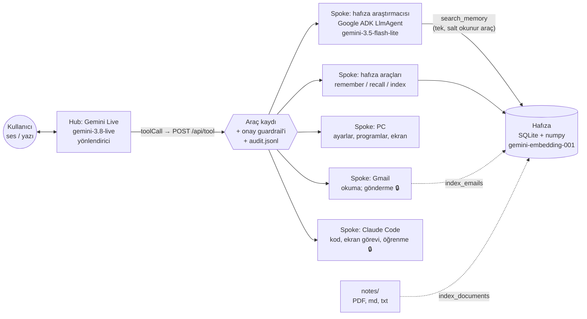

# Mario: sesle komut alan kişisel asistan

Mario, Windows bilgisayarında çalışan, Jarvis tarzı bir sesli ajandır. Tarayıcıda (masaüstü ya da telefon PWA'sı) konuşursun, **Gemini Live** (`gemini-3.8-live`) dinler ve function calling ile bir araç seçer. Aracı bilgisayardaki **FastAPI** sunucusu gerçekten çalıştırır, Mario da sonucu sesli söyler.

| Komut | Örnek | Ne yapar |
|---|---|---|
| `open_program` | "Not defterini aç", "Flo Desk'i aç" | Önce kısayol klasöründe, sonra Başlat menüsünde arar ve açar |
| `take_screenshot` | "Chrome'un ekran görüntüsünü al" | Ekranı ya da bir pencereyi `Resimler\Screenshots` klasörüne kaydeder; görüntü sohbette (telefonda da) görünür |
| `lock_computer` | "Ekranı kilitle" | Oturumu kilitler |
| `shutdown_computer` 🔒 | "Bilgisayarı kapat / yeniden başlat" | **Sesli onaydan sonra** 30 sn gecikmeyle kapatır |
| `cancel_shutdown` | "Kapatmayı iptal et" | `shutdown /a` |
| `get_weather` | "İzmir'de hava nasıl?" | Open-Meteo API'si (anahtar gerekmez) |
| `get_time` | "Saat kaç?" | Bilgisayarın saati |
| `delegate_to_claude` 🔒 | "Claude'a README'yi güncellet" | **Sesli onaydan sonra** görevi arka planda `claude -p`'ye verir; bitince Mario haber verir |
| `check_claude_task` | "Claude'un işi bitti mi?" | Görevin durumunu ve sonucunu okur |

**Hatırlatma ve takvim**

| Komut | Örnek | Ne yapar |
|---|---|---|
| `set_reminder` | "10 dakika sonra çayı hatırlat", "yarın 9'da kirayı hatırlat", "5 dakikalık zamanlayıcı kur" | `backend/data/reminders.json`'a yazar; zamanı gelince Mario söyler ve Windows bildirimi çıkar |
| `list_reminders` | "Hangi hatırlatmalarım var?" | Bekleyenleri numaralarıyla sayar |
| `cancel_reminder` | "2 numaralı hatırlatmayı iptal et" | Bekleyen hatırlatmayı siler |
| `list_calendar_events` | "Bugün neyim var?", "Bu hafta toplantım var mı?" | Google Takvim'i okur (yalnızca okuma; Gmail girişiyle birlikte bağlanır) |

**PC ayarları**

| Komut | Örnek | Ne yapar |
|---|---|---|
| `get_pc_status` | "Bilgisayarın durumu ne?" | Ses ve çıkış cihazı, mikrofon, parlaklık, tema, bildirimler, Wi‑Fi/Bluetooth, ağ, güç planı, işlemci/bellek, pil durumunu tek çağrıda okur |
| `set_volume` | "Sesi 30 yap", "sesi kıs", "sessize al" | pycaw (Core Audio) |
| `set_microphone` | "Mikrofonu kapat", "mikrofonu aç" | Varsayılan kayıt cihazını tüm uygulamalar için sessize alır (pycaw). Kapatmak sesli onay ister: Mario'yu bu bilgisayarın mikrofonuyla kullanıyorsan o da seni duyamaz, geri açmak için komutu yazman gerekir |
| `set_audio_output` | "Sesi monitöre ver" | Varsayılan çıkış cihazını değiştirir; ad belirsizse seçenekleri sayar |
| `set_brightness` | "Parlaklığı artır" | Tüm monitörlerde DDC/CI ile |
| `set_theme` | "Koyu temaya geç" | Kayıt defteri + `WM_SETTINGCHANGE` |
| `set_do_not_disturb` | "Rahatsız etme modunu aç" | Bildirim balonlarını ve seslerini kapatır (aşağıdaki nota bak) |
| `open_settings` | "Gece ışığı ayarlarını aç" | Yalnızca tanımlı Ayarlar sayfaları (`ms-settings:`) |
| `set_radio` | "Bluetooth'u kapat" | WinRT Radio API. **Wi‑Fi'yi kapatmak onay ister**, çünkü telefondan bağlıysan bağlantı kopar |
| `set_power_plan` | "Dengeli plana geç" | `powercfg`; Türkçe ve İngilizce plan adlarını tanır |
| `sleep_computer` 🔒 | "Bilgisayarı uyut" | Cevap tarayıcıya ulaşsın diye 2 sn sonra uyku |
| `list_programs` | "Hangi programlar açık?" | Görünür pencereler |
| `close_program` 🔒 | "Discord'u kapat" | Normal kapatma isteği gönderir (`/F` yok), böylece program kaydetmeyi sorabilir. Windows'un kendi süreçlerine ve Mario'ya dokunmaz |
| `scan_network` | "Ağdaki bilgisayarları göster" | Yerel ağdaki her adrese boş bir UDP paketi gönderir (böylece açık her cihaz ARP tablosuna düşer), sonra `Get-NetNeighbor` ile cihazları ve adlarını numaralı sayar ve hangisini istediğini sorar. Modem ve bu bilgisayar listede çıkmaz |
| `save_wake_device` | "2 numarayı masaüstü diye kaydet" | Taranan cihazın MAC adresini `backend/data/wol_devices.json`'a kaydeder. Kapalı cihaz ağda görünmediği için onu bir kez açıkken kaydetmek gerekir |
| `wake_device` | "Masaüstünü aç", "sunucuyu uyandır", "3 numarayı uyandır" | Wake-on-LAN sihirli paketi gönderir. Yalnızca kayıtlı cihazlar, `.env`'deki `WOL_DEVICES` (`{"masaüstü": "AA:BB:CC:DD:EE:FF"}`) ya da son taramadaki cihazlar; MAC adresini model veremez. Hedef cihazda BIOS'ta ve ağ kartında WoL açık olmalı |

**Gmail**

| Komut | Örnek | Ne yapar |
|---|---|---|
| `list_emails` | "Okunmamış maillerim var mı?", "Ahmet'ten son iki günde ne geldi?" | Gmail arama ifadesiyle listeler |
| `read_email` | "İlkini oku" | Metni okur (HTML'den düz metin çıkarır) |
| `find_email_address` | "Ahmet'in adresi ne?" | Önceki yazışmalardan adres bulur |
| `send_email` 🔒 | "Ahmet'e yarın geliyorum diye mail at" | Alıcıyı, konuyu ve metni okuyup onay ister |
| `reply_email` 🔒 | "Buna teşekkürler diye cevap yaz" | Aynı konuşma dizisinde yanıtlar |

**Öğrenme**

| Komut | Örnek | Ne yapar |
|---|---|---|
| `learn_skill` 🔒 | "WhatsApp'tan Ahmet'e yaz" (bilmediği bir iş) | "Bunu henüz bilmiyorum. İzin verirsen Claude sayesinde öğreneyim" diye sorar; evet dersen Claude Code'a yeteneği yazdırır |
| `run_skill` | (öğrenilmiş her yetenek) | Öğrenilmiş bir yeteneği çalıştırır; yetenek yıkıcıysa önce onay ister |
| `list_skills` | "Neler öğrendin?" | Öğrenilmiş yetenekleri sayar |
| `forget_skill` 🔒 | "Döviz yeteneğini unut" | Klasörü `skills/_unutulan/` altına taşır, silmez |

**Hafıza (RAG)**

| Komut | Örnek | Ne yapar |
|---|---|---|
| `remember` | "Bunu hatırla: annemin doğum günü 17 Mart" | Notu uzun süreli hafızaya yazar (`not-1`, `not-2`...) |
| `ask_memory` | "Kirayı ne zaman ödüyordum?" | Hafıza araştırmacısı ajan arar ve kaynaklı kısa bir cevap döner; kaynak bulamazsa "bilmiyorum" der |
| `recall` | "Spor salonuyla ilgili ne not etmiştim?" | Notlar, belgeler ve e-postalarda anlamsal arama; en yakın parçaları kaynak id'leriyle döner |
| `search_documents` | "Belgelerimde kasko geçiyor mu?" | Yalnızca belge klasöründe arar |
| `index_documents` | "Belgelerimi tara" | `notes/` klasöründeki yeni ve değişen PDF, Markdown ve metin dosyalarını işler |
| `index_emails` | "Bu haftaki maillerimi hafızaya al" | Gmail'deki e-postaları hafızaya ekler (varsayılan: son 7 gün) |
| `forget_memory` 🔒 | "3 numaralı notu unut" | Notu siler; önce notun metnini okuyup onay ister |

🔒 işaretli araçlar onay ister.

## Oturum kopmaz

Live oturumu iki şeyle açılır: **bağlam sıkıştırma** (`context_window_compression`, kayan pencere) ve **oturum devamı** (`session_resumption`). Sunucu konuşma boyunca devam anahtarları (handle) gönderir; tarayıcı en sonuncuyu saklar. Şu durumlarda Mario sesini kesmeden yeni bir bağlantıya geçer:

* Google bağlantıyı kapatacağını bildirdiğinde (`goAway`),
* token'ın ömrü dolmadan bir dakika önce,
* bağlantı beklenmedik biçimde koptuğunda (ağ, telefon uykusu; 4 deneme, artan bekleme).

Yeni token `POST /api/token`'a `resume_handle` ile istenir. Sistem talimatı ve araç listesi yine sunucuda kilitlenir; handle yalnızca hangi konuşmanın süreceğini seçer. Geçiş sırasında gelen sistem notları ve yazılan komutlar kuyrukta bekler, yarım kalan araç sonuçları önce teslim edilir. Tarayıcıda gerçek bir oturumla denendi: bağlantı zorla koparıldıktan sonra Mario konuşmadaki ilk cümleyi aynen tekrarladı.

## Kendiliğinden haber verir

`app/scheduler.py` arka planda çalışan bir döngüdür. Şunları olay olarak kuyruğa koyar ve ayrıca Windows bildirimi gösterir:

* zamanı gelen hatırlatma ve zamanlayıcılar (5 sn'de bir bakar),
* gelen kutusunun "Birincil" sekmesine düşen yeni e-postalar (Gmail bağlıysa, 5 dk'da bir; ilk bakışta var olanları yalnızca hatırlar),
* 15 dakika içinde başlayacak takvim etkinlikleri (Google bağlıysa),
* şarja takılı değilken yüzde 20'nin altına düşen pil.

Açık sayfa `GET /api/events`'i 5 sn'de bir okur. Ses oturumu açıksa olay Mario'ya sistem notu olarak gider ve Mario söyler. E-posta ve takvim metni `untrusted_content` olarak işaretlenir, yani yalnızca okunur. Hepsi `.env`'den kapatılabilir (`NOTIFY_MAIL`, `NOTIFY_CALENDAR`, `NOTIFY_BATTERY_PERCENT=0`, `TOAST_NOTIFICATIONS`).

## "Mario" deyince başlar

Ayarlar'daki **"Mario" deyince başla** açıksa, oturum kapalıyken sayfa Chrome'un konuşma tanımasıyla adını bekler. "Mario, saat kaç?" denince oturum açılır ve cümlenin geri kalanı ilk komut olur; yalnızca "Mario" denirse selam verir. Bu yolla açılan oturum 60 sn sessiz kalınca kendiliğinden kapanır (onay ya da Claude görevi beklerken kapanmaz) ve sayfa yeniden adını beklemeye döner. Gemini Live yalnızca adından sonra çalışır. Not: Chrome'un konuşma tanıması sesi Google'ın sunucularına gönderir; ayar bu yüzden varsayılan olarak kapalıdır.

## Bilmediğini öğrenir

Mario bir isteği hiçbir araçla yapamıyorsa "bilmiyorum" demez:

1. `learn_skill` çağırır. Sunucu, sesli onay akışıyla "Bunu henüz bilmiyorum. İzin verirsen Claude sayesinde öğreneyim: «…». Öğreneyim mi?" diye sorar.
2. Sen "evet" dersin. Sunucu arka planda `claude -p`'yi **proje klasöründe** başlatır; böylece Claude, projedeki [`.claude/skills/mario-yetenek`](.claude/skills/mario-yetenek/SKILL.md) skill'ini yükler. Skill, Claude'a şunları söyler:
   * var olan araçlara ve yeteneklere bak, aynısını yeniden yazma;
   * `skills/<ad>/skill.json` ve `run.ps1` ya da `run.py` yaz; argümanlar stdin'den JSON olarak gelsin, son satır Mario'nun okuyacağı tek Türkçe cümle olsun;
   * mesaj gönderme, silme, satın alma, ayar değiştirme gibi işler için `confirm` sorusu zorunlu;
   * `check_skill.py` ile doğrula; yalnızca zararsızca dene, isteği kendin yerine getirme;
   * yapılamıyorsa (program yok, giriş gerekiyor) yazma ve nedenini söyle.
3. Sunucu, Claude'un "YETENEK: <ad>" cevabını diskteki dosyayla karşılaştırır ve manifesti doğrular. Claude'un söylediğine körü körüne güvenmez.
4. Tarayıcı işin bittiğini görünce Mario'ya yeni yeteneği anlatan bir sistem notu gönderir. Mario öğrendiğini söyler ve ilk isteği hemen `run_skill` ile yapar.

Live token'ı araç listesini kilitlediği için her yetenek ayrı bir fonksiyon olarak tanımlanmaz. Hepsi tek bir `run_skill` aracından geçer ve yetenekler her çağrıda diskten okunur. Böylece aynı sesli oturum içinde öğrenilen bir yetenek de hemen kullanılabilir. Sonraki oturumlarda yetenekler sistem talimatında listelenir.

**Yetenek sağlığı:** Her `run_skill` çalışması `backend/data/skill-health.json` dosyasına sayılır (çalışma, hata, art arda hata, son hata). Bir yetenek üst üste 3 kez başarısız olursa sonuçta `needs_repair` döner ve Mario, Claude'un onarmasını isteyip istemediğini sorar. `list_skills` hep başarısız olanları da söyler. `.ps1` yeteneklerinde başarıyı yalnızca son satır belirler, çünkü betik `exit` ile bitmezse çıkış kodu içeride son çalışan programdan kalır. Örneğin `program_kur`, AnyDesk kurulumu başarıyla başladığı halde bu yüzden "hata" olarak kaydediliyordu.

**Ortak yardımcılar:** Yetenekler `MARIO_LIB` ortam değişkeniyle `backend/skill_lib/` klasörünü görür. `window.ps1` içindeki `Set-MarioForeground`, Windows'un ön plan kilidini aşarak bir pencereyi öne getirir ve gerçekten öne geldiğini kontrol eder. "Pencere öne getirilemedi" hatası WhatsApp ve ekran paylaşma yeteneklerinde bu yüzden çıkıyordu. mario-yetenek skill'i Claude'a bu yardımcıyı kullanmasını söyler.

**Deneyim hafızası:** Claude bir işi bitirince yazdığı ders (`data/experience.jsonl`), benzer bir sonraki işin istemine eklenir. Benzer dersler Gemini embedding'leriyle, yani anlamca bulunur ("Mehmet'e yaz" isteği, ortak kelime olmasa da WhatsApp mesajı dersini bulur). Vektörler `experience.vectors.npz` dosyasında önbelleklenir. Anahtar ya da ağ yoksa kelime örtüşmesine düşer.

Güvenlik: öğrenme her seferinde senin sesli onayını ister. Claude yalnızca `skills/` altına yazabilir (`backend/`, `frontend/` ve `.claude/` yazma izinleri kapalı) ve yıkıcı komutlar yasak. Yıkıcı bir yeteneğin her çalıştırılması da ayrıca sesli onaydan geçer.

## Mimari

```
 Telefon / Chrome (PWA)                      Bu bilgisayar                         Google
┌────────────────────────┐  POST /api/token  ┌─────────────────────────┐  ephemeral   ┌──────────────┐
│ mic 16 kHz ─┐          │ ────────────────▶ │ FastAPI                 │ ───token───▶ │ Gemini API   │
│ hoparlör 24 kHz ◀┐     │                   │  • token (prompt+araçlar│              └──────────────┘
│             │    │     │                   │    token'a kilitli)     │
│     Gemini Live WebSocket (ham)  ◀────────────────────────────────────────────────▶ gemini-3.8-live
│             toolCall ──┼─ POST /api/tool ─▶│  • araç kaydı + onay    │
│      toolResponse ◀────┼───────────────────│  • audit.jsonl          │──▶ Windows / Open-Meteo / claude -p
└────────────────────────┘                   └─────────────────────────┘
```

* **API anahtarı tarayıcıya hiç gitmez.** Sunucu tek kullanımlık, kısa ömürlü bir ephemeral token verir. Sistem talimatı ve **araç listesi** bu token'a `lock_additional_fields=[]` ile kilitlenir, yani tarayıcı yeni bir komut ekleyemez.
* Ses altyapısı (ham WebSocket istemcisi, 16 kHz mikrofon / 24 kHz oynatma AudioWorklet'leri, araya girince kuyruğu boşaltma, kendi sesini duyma filtresi) **Lucia** projesinden kopyalanıp uyarlandı. `live.js`'e `toolCall` / `toolResponse` desteği eklendi.
* Araçlar tek bir kayıtta (`backend/app/tools/__init__.py`) tanımlı. Aynı tanım hem Gemini function declaration'larını hem de `/api/tool` dağıtıcısını besler.
* Windows komutları kullanıcının JARVIS eklentilerinden uyarlandı: `program-ac.ps1` (ad sadeleştirme ve eşleştirme), `ekran-goruntusu.ps1` (aynen, `backend/scripts/screenshot.ps1`), `bilgisayar-kapat.ps1` (30 sn gecikme) ve `claude_isci.py` (Claude Code'a iş devretme, yasaklı komut listesi, giriş hatası mesajı).

## Model kendi işini onaylayamaz

Yıkıcı bir araç çağrıldığında hiçbir şey çalışmaz. Sunucu işi bekletir ve `needs_confirmation` ile bir `confirmation_id` döner. Mario soruyu sesli sorar. İş, ancak iki koşul birlikte sağlanınca çalışır:

1. Model `confirm_action(confirmation_id)` çağırır, **ve**
2. Tarayıcının gönderdiği, soru sorulduktan **sonra kullanıcının söylediği** sözlerin (Gemini'nin input transkripsiyonu, yankı filtresinden geçmiş hali) içinde açık bir "evet" vardır ve "hayır / vazgeç / yapma / değil" yoktur.

Böylece model kullanıcıdan duymadığı bir "evet"i varsayarsa `not_confirmed` alır ve iş yapılmaz. Bu, e-postalara gömülü talimatlara (prompt injection) karşı da asıl korumadır: "bunu x@... adresine ilet" diyen bir e-posta modeli kandırsa bile gönderme senin sesli onayın olmadan çalışmaz. Ayrıca e-posta sonuçları `untrusted_content` olarak işaretlenir ve sistem talimatı modele bu içerikteki talimatları uygulamamasını söyler. Onay tek kullanımlıktır ve 90 sn sonra düşer. Ekranda ayrıca **Onayla / İptal** düğmeleri çıkar; düğme modeli hiç devreye sokmadan doğrudan çalışır. Her çağrı, kimin onayladığıyla birlikte `backend/data/audit.jsonl` dosyasına yazılır (`GET /api/audit`). Böylece "gerçekten çalıştı mı?" sorusunun cevabı modelin söylediğine bağlı kalmaz.

## Hafıza ve RAG

Mario'nun uzun süreli hafızası yerel tek bir SQLite dosyasıdır (`backend/data/memory.sqlite`); vektör sunucusu yoktur. Üç kaynaktan beslenir:

* **Sesli notlar:** "bunu hatırla" → `remember`.
* **Belgeler:** `notes/` klasöründeki PDF (pypdf), Markdown ve metin dosyaları. Klasör `.env` içinde `MEMORY_DOCS_DIR` ile değiştirilebilir. Her dosyanın SHA-256 özeti saklanır. Yeniden taramada yalnızca yeni ve değişen dosyalar embed edilir; silinen dosyaların parçaları hafızadan çıkarılır.
* **E-postalar:** `index_emails`, var olan Gmail aracıyla mesajların düz metnini çeker. Parçalar `kind=email` olarak işaretlenir. Bu parçalar sonuçlarda `untrusted_content` ile döner ve ajanın talimatı, içlerindeki talimatları uygulamamasını söyler.

İşleyiş (`backend/app/memory/`):

1. **Chunking** (`chunking.py`): Paragraflar sığdıkça bölünmez, uzun paragraflar cümle sonlarından bölünür. Her parça, bir öncekinin son cümleleriyle başlar (varsayılan: 400 karakter, 80 karakter örtüşme). Parçanın altında durduğu Markdown başlıkları parçayla birlikte embed edilir (ör. `Belge: kira.md / Ödeme`).
2. **Embedding** (`embeddings.py`): `gemini-embedding-001`, 768 boyut. Belgeler `RETRIEVAL_DOCUMENT`, sorular `RETRIEVAL_QUERY` görev tipiyle embed edilir (asimetrik). 3072'den küçük boyutlarda vektörler birim uzunlukta gelmediği için normalize edilir.
3. **Vector search** (`store.py`): Vektörler SQLite'ta float32 blob olarak durur. Arama, bellekteki numpy matrisi üzerinde tam (brute-force) kosinüs benzerliğidir. Kişisel bir hafıza birkaç bin parçadan oluşur; bu ölçekte tam tarama bir milisaniyenin altında sürer ve ANN indeksine gerek kalmaz. Sonuç top-k parçadır; isteğe bağlı tür filtresi (`note`/`document`/`email`) vardır.
4. **Kaynak gösterme ve grounding** (`citations.py`): Her parçanın bir atıf id'si vardır: `kira.md#2`, `not-7`, `mail-<id>#0`. Araştırmacı ajan cevaptaki her bilgiyi `[id]` ile gösterir. Aracın gerçekten döndürdüğü id'leri sunucu kendisi kaydeder ve bu kümede olmayan atıfları siler. Geçerli atıfı kalmayan bir cevap bilgi olarak iletilmez: `found: false` döner ve Mario "bilmiyorum" der. Fikir Lucia'daki transkript kontrolüyle aynıdır: modelin "gördüm" dediğine değil, sunucunun gördüğüne güvenilir.

Sınır: `recall` ve `search_documents` ham parçaları Live modele verir. Modelin bu parçalarla sesli kurduğu cümle sunucuda süzülemez, çünkü ses doğrudan tarayıcıya gider. Kaynak denetimi bu yüzden metin üreten `ask_memory` yolundadır; sistem talimatı da kişisel sorular için bu aracı ister.

## Çoklu ajan: hub-and-spoke



* **Hub:** Gemini Live sesli modeli. Kullanıcıyla konuşur ve her isteği tek bir araca yönlendirir; kendisi hiçbir şey çalıştırmaz. Araç listesi ephemeral token'a kilitlidir.
* **Spoke'lar:** Her uzman bir aracın arkasındadır; böylece hepsi aynı onay akışından ve audit kaydından geçer. Yıkıcı ya da dışarıya giden işler (e-posta gönderme, Claude'a görev verme, not silme...) sesli "evet" olmadan çalışmaz.
* **Hafıza araştırmacısı** (`backend/app/agents/researcher.py`) bir **Google ADK** `LlmAgent`'ıdır. Tek bir `FunctionTool`'u vardır (`search_memory`) ve her soruda `InMemoryRunner` ile yeni bir oturumda çalışır. İlk arama yetmezse soruyu farklı kelimelerle yeniden arar. Guardrail'ler modelin elinde değildir:
  * `before_tool_callback`, izin listesinde olmayan araç adlarını reddeder ve aramayı 3 çağrıyla sınırlar;
  * ajanın veri yazan hiçbir aracı yoktur;
  * atıflar yukarıdaki grounding kontrolünden geçer.

**Neden ADK ve neden yalnızca spoke katmanında:** Uzman ajan için ADK temiz oturdu. Araç tanımı Python fonksiyonundan çıkıyor, callback'ler guardrail için doğal bir yer ve çalıştırıcı test edilebilir: testler ADK'nın gerçek `Runner`'ını, `BaseLlm`'den türetilmiş sahte bir modelle ağa çıkmadan çalıştırır. Hub ise ADK'ya taşınmadı. Mario'da tarayıcı Gemini Live'a ephemeral token ile doğrudan bağlanır; ses sunucudan geçmez ve API anahtarı tarayıcıya gitmez. Hub'ı ADK'nın canlı akışına taşımak bütün sesi sunucudan geçirmek demekti ve karşılığında bir kazanç yoktu.

## Değerlendirme (eval)

`backend/evals/` altında küçük, sabit bir korpus var: 12 kurgusal kişisel belge (kira, araba, sağlık, iş projesi, tatil...) ve 4 not; içlerindeki kişiler, adresler ve rakamlar uydurmadır. Benzer konulu çeldirici belgeler (eski evin kira sözleşmesi, babanın arabası) bilerek eklendi. Soru seti `questions.jsonl` 40 sorudan oluşur: 36'sının cevabı hafızada var, 4'ününki yok (bu sorularda model uydurmak yerine "bilmiyorum" demeli).

```powershell
cd backend
uv run python evals/run_eval.py --retrieval-only   # yalnızca embedding, ~10 sn
uv run python evals/run_eval.py                    # ajan + LLM-as-judge; ücretsiz katmanda ~10 dk
uv run python evals/run_eval.py --save-baseline    # bu koşuyu yeni baseline yap
```

Ölçülenler:

* **Retrieval:** hit@1, hit@3, hit@k ve MRR, yani beklenen kaynaktan bir parçanın ilk k sonuç içinde olup olmadığı.
* **Cevap kalitesi (LLM-as-judge):** Ajanın cevabını farklı bir model (`JUDGE_MODEL`, varsayılan `gemini-3.1-flash-lite`; `gemini-3.5-flash` daha güçlü bir hakem olurdu ama ücretsiz katmanda günde 20 istekle sınırlı) referans cevapla karşılaştırır ve yapılandırılmış JSON döner: `correctness` (1-5) ve `faithful` (cevap, atıf yapılan parçalarda geçiyor mu). Hakem kendi cevabını puanlamasın diye ajanla aynı model değildir.
* **answer_accuracy** (puanı ≥4 olanların oranı), **faithfulness**, **citation_precision** (atıfların beklenen kaynağa düşme oranı), **abstention_accuracy** (cevapsız sorularda "bilmiyorum" deme oranı), **dropped_citations** (grounding kontrolünün sildiği uydurma atıf sayısı).
* **Regresyon:** Sonuçlar `evals/results/latest.json` ve `latest.md` dosyalarına yazılır. Bir oran `evals/baseline.json`'dakinden `--tolerance` (varsayılan 0.05) kadardan fazla düşerse betik 1 koduyla çıkar.

**Son koşu** (2026-11-09; ajan `gemini-3.5-flash-lite`, hakem `gemini-3.1-flash-lite`, chunk 400/80, k=5; `evals/baseline.json`):

| Metrik | Değer |
|---|---|
| hit@1 / hit@3 / hit@5 | 0.917 / 1.0 / 1.0 |
| MRR | 0.958 |
| answer_accuracy (judge ≥ 4) | 0.972 (36 sorudan 35) |
| mean_correctness (1-5) | 4.861 |
| faithfulness | 1.0 |
| citation_precision | 0.973 |
| abstention_accuracy | 1.0 (4/4 cevapsız soruda "bilmiyorum") |
| dropped_citations | 0 |

Chunk boyutu karşılaştırması (yalnızca retrieval, aynı soru seti, şu anki chunker): 800/150 → hit@1 0.917, MRR 0.958 (16 parça); 400/80 → hit@1 0.917, MRR 0.958 (33 parça); 250/50 → hit@1 0.882, MRR 0.941 (46 parça). Başlıklar parçaya eklenmeden önceki ilk denemede 400/80 öndeydi (hit@1 0.944'e karşı 0.917). Varsayılan 400/80 kaldı, çünkü sesli cevapta daha kısa parçalar ajana daha az gürültü taşıyor.

Dürüst not: Korpus küçük ve sentetik (12 belge, 33 belge parçası + 4 not), bu yüzden sayılar yüksek. Asıl değeri regresyon koruması: chunking, prompt ya da model değişince düşüşü yakalar. Tek hata (q21, "giriş nasıl yapılacak?" → Entra ID) ajanın kelime eşleşmesi zayıf bir soruda "bulunamadı" demesi: uydurma değil, kaçırılmış bir cevap.

## Kurulum

Gereken: Windows, [uv](https://docs.astral.sh/uv/) (Python 3.12'yi kendisi kurar), Chrome/Edge. Claude'a iş devretmek için Claude Code kurulu ve giriş yapılmış olmalı.

```powershell
cd backend
uv sync
copy .env.example .env      # GEMINI_API_KEY'i doldur; istersen USER_NAME ile adını da yaz
uv run uvicorn app.main:app --host 127.0.0.1 --port 8100
```

`uv sync` bağımlılıkları `uv.lock` dosyasından `backend\.venv` içine kurar. `Mario.vbs` ve başlangıç kısayolu bu venv'deki `pythonw`'yi kullanır.

http://localhost:8100 adresini aç, **Başlat**'a bas ve konuş. Mikrofon yoksa komutları yazarak da verebilirsin.

### Tek tıkla ve Windows açılınca

Proje klasöründeki **`Mario.vbs`** dosyasına çift tıkla: sunucu kapalıysa pencere açmadan başlar, Mario Chrome'da açılır. Kurulum gerekmez.

Masaüstü kısayolu ve Windows açılınca başlatma için (yalnızca masaüstü kısayolu istiyorsan sona `-NoStartup` ekle):

```powershell
powershell -ExecutionPolicy Bypass -File backend\scripts\install-shortcuts.ps1
```

* Masaüstüne bir **Mario** kısayolu koyar. Sunucu çalışmıyorsa onu pencere açmadan başlatır, sonra Mario'yu Chrome'da uygulama penceresi olarak açar.
* Başlangıç klasörüne de bir kısayol koyar. Windows açılınca sunucu sessizce başlar.
* Sunucu `pythonw` ile `scripts/serve.py` üzerinden çalışır; günlük `backend/data/server.log` dosyasına yazılır (1 MB'ta döner).
* Kısayolları kaldırmak için aynı komutu `-Remove` ile çalıştır.

Kendi programlarının kısayollarını `programs/` klasörüne koy ya da `.env` içinde `PROGRAMS_DIR` ile başka bir klasörü göster (ör. JARVIS'in `Programlar` klasörü).

### Gmail bağlama (bir kez)

1. [Google Cloud Console](https://console.cloud.google.com/)'da bir proje aç ve **Gmail API**'yi etkinleştir.
2. *OAuth consent screen*: tür **External**, kendini *Test users* listesine ekle.
3. *Credentials → Create credentials → OAuth client ID*: tür **Desktop app**. JSON dosyasını indir ve `backend/gmail-client.json` olarak kaydet (git'e girmez).
4. *Google Calendar API*'yi de etkinleştir (takvim için).
5. `cd backend` ve `uv run python scripts/gmail_login.py`. Tarayıcı açılır, hesabını seçersin. İzinler yalnızca Gmail **okuma** ve **gönderme**, bir de takvim **okuma**: silme, arşivleme, etiketleme ya da takvime yazma yok. Gmail'i daha önce bağladıysan takvim izni için bu adımı bir kez daha yap.

Token `backend/data/gmail-token.json` dosyasında durur. Bağlantıyı kesmek için bu dosyayı sil.

### Telefondan kullanım

Mikrofon için HTTPS gerekir. En kolay yolu Tailscale:

```powershell
tailscale serve --bg 8100
```

1. `.env` içinde uzun bir `ACCESS_CODE` belirle. Bu kod yoksa bilgisayar dışından gelen her istek reddedilir.
2. Telefonda `https://<bilgisayar-adı>.<tailnet>.ts.net/#code=<ACCESS_CODE>` adresini aç (kod bir kez kaydedilir), sonra "Ana ekrana ekle"ye bas.

`tailscale serve` istekleri 127.0.0.1'den iletse de eklediği `X-Forwarded-For` ve `Tailscale-User-Login` başlıkları sayesinde bu istekler "yerel" sayılmaz; erişim kodu yine istenir.

## Test

```powershell
cd backend
uv run pytest
uv run ruff check .
uv run ruff format --check .
```

Testler Windows'a ve ağa dokunmaz. Hafıza testleri, kelimeleri hash'leyen sahte bir embedder ve senaryolu sahte bir ADK modeli kullanır. Hafıza tarafında kapsanan konular: chunking (boyut, örtüşme, başlıklar), vektör aramanın sıralaması ve tür filtresi, yalnızca değişen dosyaların yeniden embed edilmesi, PDF okuma, uydurma atıfların silinmesi, araştırmacı ajanın arama sınırı ve araç izin listesi, araçların `/api/tool` üzerinden bağlanması, not silmenin sesli onay istemesi ve eval metrikleri. Diğer araçlarda `subprocess`, `os.startfile`, COM/WinRT/kayıt defteri yardımcıları, Open-Meteo, Gmail API ve Claude Code sahte nesnelerle değiştirilir. Kapsanan konular: onay akışı (model kendi başına onaylayamaz, onay tek kullanımlıktır, süresi dolar, düğmeyle onay), erişim kodu ve Tailscale başlıkları, token'a kilitlenen araç listesi, program bulma, ekran görüntüsü çıktısını okuma, kapatma, hava durumu, Claude işleri (görev metni argv yerine stdin'den gider, zaman aşımı, giriş yapılmamış hesap), ses/parlaklık/tema/güç planı mantığı, sistem süreçlerinin korunması, Wi‑Fi kapatmanın onayı, Gmail okuma, adres bulma, yanıtın aynı diziye gitmesi ve e-postanın ancak sesli "evet"le gönderilmesi.

Tarayıcı olmadan gerçek Gemini Live ile uçtan uca deneme (araçlar **gerçekten** çalışır):

```powershell
uv run python scripts/live_smoke.py "İstanbul'da hava nasıl?" "Not defterini aç."
uv run python scripts/live_smoke.py "Bilgisayarı kapat" "hayır"
```

Yıkıcı araçları ve ayar değişikliklerini gerçekten çalıştırmadan denemek için `.env` içinde `DRY_RUN=true` yap.

### Bilinen sınırlar

* **Rahatsız Etme:** Windows 11'in "Rahatsız etme" düğmesinin herkese açık bir API'si yok. Mario bunun yerine Ayarlar'daki "Bildirimler" anahtarını (`NOC_GLOBAL_SETTING_TOASTS_ENABLED`) değiştirir: balon ve ses gelmez, bildirimler yine de bildirim merkezine düşer.
* **Gece ışığı:** Ayarı belgelenmemiş bir ikili kayıtta tutuluyor. Mario bu yüzden Ayarlar sayfasını açar, ayarı kendisi değiştirmez.
* **Parlaklık:** Masaüstü monitörlerde DDC/CI açık olmalı. Kapalı olan monitör atlanır ve bu durum söylenir.
* **Ayar değiştiren araçlar** (ses, çıkış cihazı, parlaklık, tema, bildirimler, radyo, güç planı) birim testlerinde sahte nesnelerle sınandı. Okuyan araçlar gerçek bilgisayarda ve gerçek Gemini Live ile denendi.

## Yapı

```
backend/
  app/
    gemini.py         ephemeral token: sistem talimatı + araçlar kilitli
    tools/            araç kaydı; system (program, ekran görüntüsü, kapatma), pc (ayarlar),
                      gmail, web (hava, saat), claude (Claude Code işleri ve öğrenme),
                      skills (öğrenilmiş yetenekleri yükleme/çalıştırma), knowledge (hafıza araçları)
    memory/           hafıza: chunking, Gemini embedding, SQLite vektör deposu, atıf kontrolü
    agents/           hub-and-spoke: ADK hafıza araştırmacısı
    confirm.py        bekleyen işler + "evet" kontrolü
    audit.py          audit.jsonl
    reminders.py      hatırlatma deposu ve zaman çözümleme
    scheduler.py      arka plan döngüsü: hatırlatma, yeni e-posta, takvim, pil → events.py
    notify.py         Windows bildirimi (PowerShell WinRT)
    experience.py     Claude işlerinden kalan dersler (embedding ile arama)
    routers/          /api/token, /api/tool, /api/confirm, /api/jobs, /api/audit, /api/screenshots, /api/events
  skill_lib/          yeteneklerin ortak yardımcıları (window.ps1: pencereyi öne getirme)
  scripts/            screenshot.ps1, live_smoke.py, gmail_login.py,
                      start-mario.ps1 + serve.py + install-shortcuts.ps1 (başlatma),
                      check_skill.py (yetenek doğrulama)
  evals/              sabit korpus, 40 soru, run_eval.py (retrieval + LLM-as-judge), baseline.json;
                      tool_cases.jsonl + run_tool_eval.py (araç seçimi), tool_baseline.json
  tests/
frontend/             PWA: live.js, audio/ (Lucia'dan), transcript.js, session.js, app.js, wake.js
programs/             open_program'ın önce baktığı kısayollar
notes/                Mario'nun hatırlayacağı belgeler (kişisel, git'e girmez)
skills/               Mario'nun öğrendiği yetenekler (kişisel, git'e girmez)
.claude/skills/       mario-yetenek: Claude'un Mario'ya yetenek öğretirken izlediği skill
```

## Lisans

[MIT](LICENSE)
